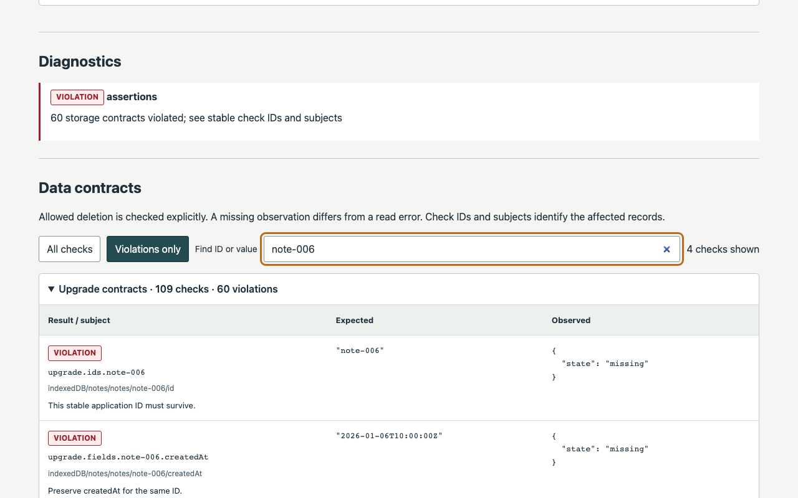

# OriginRehearsal

Rehearse web-app upgrades with retained browser profiles and explicit data contracts.

For notes apps, editors, whiteboards and other apps that keep important data in a browser. A fresh install can work while an upgrade loses existing users' text, IDs or relationships. OriginRehearsal runs the old app, seeds it through its own UI/API, closes Chromium completely, serves the new build on the **same origin**, and reopens the **same isolated profile**.

It first runs a separate **OLD → OLD cold control** with the same deterministic seed inputs. Selected snapshots are observations. They are never restored into another context.

The bundled synthetic notes example produces real results:

| Build | Fresh install | Existing-profile upgrade |
| --- | --- | --- |
| GOOD | Creates notes | **PASS**: 20 IDs, exact text, timestamps and tag relationships retained |
| BAD | Creates and reads a new note | **VIOLATION**: required `note-006` through `note-020` are missing |
| Same-count mutant | Creates notes | **VIOLATION**: 20 rows remain, but text and a tag relationship are corrupted |



[Watch the real 25-second demo](https://mikonyaa.github.io/originrehearsal/) · [PASS report](https://mikonyaa.github.io/originrehearsal/reports/good.html) · [VIOLATION report](https://mikonyaa.github.io/originrehearsal/reports/bad.html) · [Release assets](https://github.com/mikonyaa/originrehearsal/releases/tag/v0.1.0)

## First run

Prerequisites: **Node 24.21.0 or later Node 24 LTS**, npm, macOS arm64 or Ubuntu Linux x64, network access for dependencies and the first Chromium download. The installer uses the Chromium revision pinned by Playwright **1.64.0**, without a hidden postinstall download. The browser download can take more than a minute. Linux may need system packages; see troubleshooting.

Install the versioned GitHub Release archive in a fresh directory. There is no npm-registry publication for this release.

```sh
mkdir originrehearsal-demo
cd originrehearsal-demo
npm init -y
curl -fL -o originrehearsal-0.1.0.tgz \
  https://github.com/mikonyaa/originrehearsal/releases/download/v0.1.0/originrehearsal-0.1.0.tgz
npm install --ignore-scripts ./originrehearsal-0.1.0.tgz
./node_modules/.bin/originrehearsal --version
./node_modules/.bin/originrehearsal install-browser
./node_modules/.bin/originrehearsal doctor
./node_modules/.bin/originrehearsal demo --out ./artifacts/demo --no-open
```

The demo command exits 0 only when GOOD returns PASS and BAD returns VIOLATION, each with a passing cold control. **The BAD JSON/HTML report stays VIOLATION.** Open `artifacts/demo/bad/report.html` directly from disk; it needs no server, CDN or fetch. It shows the missing IDs and their expected content.

For a case you can edit:

```sh
./node_modules/.bin/originrehearsal init --dir ./example
./node_modules/.bin/originrehearsal run ./example/upgrade-case.json --out ./artifacts/run --no-open
./node_modules/.bin/originrehearsal run ./example/bad-case.json --out ./artifacts/bad --json --no-open
# The last command intentionally exits 1.
./node_modules/.bin/originrehearsal report ./artifacts/run/run.json --out ./artifacts/rendered --no-open
```

`init` includes case files, `.mjs` hooks, the synthetic specification and prepared OLD/NEW builds. It refuses an existing destination. Use a fresh output directory for every run; neither active runs nor existing `run.json` files are overwritten. `--json` sends exactly one result to stdout; progress goes to stderr. `--headed` shows the actual Chromium windows. Reports open automatically in an available desktop session unless `--no-open`, `--json` or CI is used.

The Release also includes SHA256SUMS, a source/CI manifest, synthetic reports, the standalone example and demo media. Verify the archive against the released checksum before installation when your workflow requires integrity checking.

## Your application

Prepare two immutable **static dist directories** with distinct build IDs. Add a sentinel that your versioned application JavaScript sets after it actually executes:

```js
// In the compiled application JavaScript. Absent from the initial HTML.
document.documentElement.dataset.appBuild = 'my-app-v2';
// Only after storage opens and migrations complete:
document.documentElement.dataset.appReady = 'true';
// On a migration failure, expose a useful error, without claiming readiness:
// document.documentElement.dataset.appError = error.message;
```

Adapt [the working case](examples/notes/upgrade-case.json) and [the hooks](examples/notes/upgrade.hooks.mjs). All paths resolve relative to the case, including spaces and Unicode. The [JSON schema](schemas/upgrade-case.schema.json) aids editors; runtime validation additionally enforces different build IDs, distinct target names and safe app paths.

Declare `seedInputs`, observed localStorage keys/IDB stores and resource limits. The hooks are explicit trusted local code:

| Hook | Input | Responsibility |
| --- | --- | --- |
| `seed` | `{ page, origin, inputs }` | Use the application's UI or documented API and await completed writes |
| `assertSeed` | `{ snapshot, checks }` | Independently confirm seed values; declare one logical fingerprint with normalization rules |
| `verifyCold` | `{ before, after, checks }` | Verify OLD → OLD against the old schema and old values |
| `verify` | `{ before, after, checks }` | Verify the application's intended upgrade semantics |

The last three receive deeply frozen snapshots and no page. Each must emit nonempty storage assertions with stable IDs, selected subjects, expected/actual values and explanations. A fingerprint alone is not a contract. The SDK provides `Checks.equal`, `requiredIds`, `preservedFields`, `transformed`, `allowedAbsent`, `requiredPresence` and `references`; `values`, `records` and `localJSON` help read observations. Import them from **`originrehearsal` in `.mjs`**. No TypeScript loader or source-repo devDependencies are required.

```js
import { values, localJSON } from 'originrehearsal';

export function verify({ before, after, checks }) {
  const old = values(before, 'notes', 'notes');
  const next = values(after, 'notes', 'notes');
  checks.requiredIds('notes.ids', 'indexedDB/notes/notes', next, old.map(note => note.id));
  checks.preservedFields('notes.fields', 'indexedDB/notes/notes', old, next, ['createdAt', 'tagIds']);
  for (const note of old) {
    const migrated = next.find(row => row.id === note.id);
    checks.transformed(`notes.body.${note.id}`, `indexedDB/notes/notes/${note.id}/body`,
      migrated?.body ?? { state: 'missing' }, note.text, 'Rename text to body, preserving exact content.');
  }
  checks.equal('prefs.move', 'localStorage/preferences', localJSON(after, 'preferences'),
    localJSON(before, 'ui-prefs'), 'Move preferences unchanged.');
}
```

The app author decides what is required, transformed or intentionally deleted. An allowed removal of `scratch` passes in the example; requiring that same store to remain produces a violation. Counts alone cannot establish a useful application contract. Preparing real builds, reliable readiness and meaningful contracts takes application-specific work.

## Evidence and outcomes

Every normal run uses one loopback gateway with a single `listen(0)` (or your explicit free port):

```text
control profile: OLD → seed → snapshot → full close → OLD → snapshot → verifyCold
upgrade profile: OLD → seed → snapshot → full close → NEW → snapshot → verify
                 └── same inputs and logical baseline ──┘
```

The profiles are separate. The control verifies OLD cold-start and the harness; it does not read the main run's physical profile. No additional OLD reopen is inserted into the main upgrade path.

Node independently challenges `GET /__originrehearsal__/phase?challenge=<nonce>` to verify the active build hash. The page's JavaScript-set DOM sentinel independently verifies the **executed** app ID. A NEW response header or HTML is insufficient. Chromium's actual userDataDir is checked through CDP; browser disconnection and process exit are confirmed before changing the gateway root. The report contains opaque profile identities, not private absolute profile paths.

The JSON includes tool/browser/Node/OS versions, config/hook/build digests, origin, run links, seed input digest, chosen logical fingerprint and normalization, timed phases, version evidence, coverage, snapshots, checks, diagnostics and cleanup. The hook digest covers the explicitly named entry file; review any modules it imports as trusted code.

| Outcome | Exit | Meaning |
| --- | ---: | --- |
| PASS | 0 | Lifecycle, versions, cold control, declared coverage and required contracts confirmed |
| VIOLATION | 1 | NEW executed; correctly observed data violates the application contract |
| ERROR | 2 | Configuration, seed, launch, version/readiness, migration, hook, probe or cleanup prevented a complete verdict |
| UNSUPPORTED | 3 | A detected service worker, data type or mode is outside coverage |
| Interrupted | 130 | Ctrl-C; evidence and owned cleanup attempted/verified as reported |

Precedence: ERROR → UNSUPPORTED → VIOLATION → PASS. Timeouts and migration aborts are errors, not proof of missing data. Empty checks, failed probes and incomplete snapshots never pass. A worker supervises asynchronous deadlines; the CLI's parent also enforces a deadline on stalled synchronous hooks and only terminates processes confirmed to belong to that run.

## Read-only probes

Only declared targets are read. Empty strings differ from missing localStorage keys. `localJSON` parses explicitly for a contract and fails clearly on invalid JSON.

For IDB the browser first enumerates `indexedDB.databases()`. Absent DBs are not opened. Existing DBs use `open(name)` without a version; an unexpected `upgradeneeded` aborts accidental creation if the DB disappeared after listing. Reads use readonly transactions and await completion. Connections close in `finally` and on `versionchange`. Missing stores, read errors, blocked/aborted operations and timeouts retain distinct evidence.

Supported: string/finite-number IDB keys and JSON-compatible values. Date, Map, Set, Blob, ArrayBuffer, BigInt, undefined, NaN, cyclic values and other keys are detected **in Chromium before serialization** and return UNSUPPORTED. Record/byte limits discard incomplete observations rather than returning truncated success. No cookies, OPFS, Cache Storage or unselected storage is inspected. See [architecture and limits](docs/architecture.md).

## Scope, privacy and security

v0.1 supports prepared static builds over `http://127.0.0.1:<unchanged-port>` with **Cache-Control: no-store**. `localhost`, another port, iframe and `file://` are different origins. Reports can open with `file://`; the application rehearsal cannot.

Service workers are **unsupported**: registrations/controller are detected before seed and after readiness. They are not blocked, unregistered or cleared. A separate native stale-SW test verifies that a NEW backend and OLD executed sentinel disagree; it is not a supported CLI mode.

Not covered: production cache parity, SSR/backend commands, remote proxies, production auth, multiple open tabs, OPFS/cookie contracts, crash/interrupted-transaction migration recovery, skipped version chains or cross-browser behavior. Crashes are classified/cleaned up; their migration semantics are not rehearsed.

The CLI creates fresh, marked, restricted temporary profiles and removes its own profiles after confirmed close. It accepts no ordinary Chrome profile path. It does not kill processes by port or clean unknown leftovers. Local hooks have your user's rights and are **not sandboxed**; no remote hooks or config strings are evaluated. Review hooks, their imports and app builds before running them.

**Reports contain selected application data and are not automatically anonymized.** Keep real reports private. Do not commit profiles, auth state or private storage dumps. Public examples, video and reports here use only this project's synthetic data. Report values are escaped, including hostile `</script>` strings; controls work offline.

## Verified platforms and development

The release uses Node **24.21.0**, Playwright **1.64.0**, Chromium **156.0.8078.4** (revision **1248**). macOS arm64 is tested locally on the target workstation; the [CI workflow](.github/workflows/ci.yml) checks Ubuntu 24.04 x64 and macOS 14 arm64. Check the release manifest and exact-commit CI for actual remote results. No Windows, Linux arm64, Firefox or WebKit support is claimed.

```sh
npm ci
npm run typecheck
npm run lint
npm run test:unit
npm run build
node ./dist/cli/main.js install-browser
npm run test:e2e
npm run test:consumer
node ./dist/cli/main.js demo --out ./artifacts/demo --no-open
npm pack --json
npm run verify:ui
npm run demo:media    # requires ffmpeg and ffprobe; records real browser video
npm run audit:publication
```

The unit suite uses Node's test runner. E2E uses native Chromium storage, independently observed fixture values, exit codes and actual process/profile lifecycle; no fakeIndexedDB substitute. The consumer suite packs the compiled product, installs it outside the repo with lifecycle scripts disabled, uses the installed executable, and exercises real good/bad/control/demo runs plus offline HTML. CI promotes its exact consumer-tested tarball without repacking. UI screenshots are checked at 1440/1024/390 px for every outcome; video is reproducible from the real runner.

Playwright already supplies persistent contexts and storage snapshots (including IndexedDB and OPFS in supporting versions). OriginRehearsal combines them with a stable build gateway, separate backend/executed-code evidence, cold control, application contracts and reports. [fakeIndexedDB](https://github.com/dumbmatter/fakeIndexedDB) is useful for API tests; [Dexie](https://github.com/dexie/Dexie.js) supplies migration mechanisms. Neither determines your application's intended preservation semantics. [Background and primary sources](docs/architecture.md#existing-tools).

## Troubleshooting

- Missing browser: run `originrehearsal install-browser`. On Linux, `install-browser --with-deps` installs Playwright's required system packages and may need privileges. It is explicit, never a postinstall side effect.
- `EADDRINUSE`: free your selected port yourself or omit `gateway.port` for one automatic port. OriginRehearsal leaves the port owner alone.
- Seed failure: inspect seed checks and saved-state timing. Do not change upgrade expectations to hide an incomplete seed.
- NEW not confirmed: check that the versioned JS sets the sentinel, and that its ID differs from OLD. Read backend and app evidence separately.
- Readiness/migration error: expose an `errorSelector`/`errorAttribute` from the app. A timeout without AFTER cannot prove data loss.
- UNSUPPORTED: inspect SW/type/limit evidence; do not clear storage or bypass detection to get a green result.
- Output already exists: use a new `--out`. Unknown retained temp directories are preserved for inspection rather than automatically deleted.

[Contributing](CONTRIBUTING.md) · [Security](SECURITY.md) · [Changelog](CHANGELOG.md) · [MIT license](LICENSE) · [Notices](NOTICE.md)
